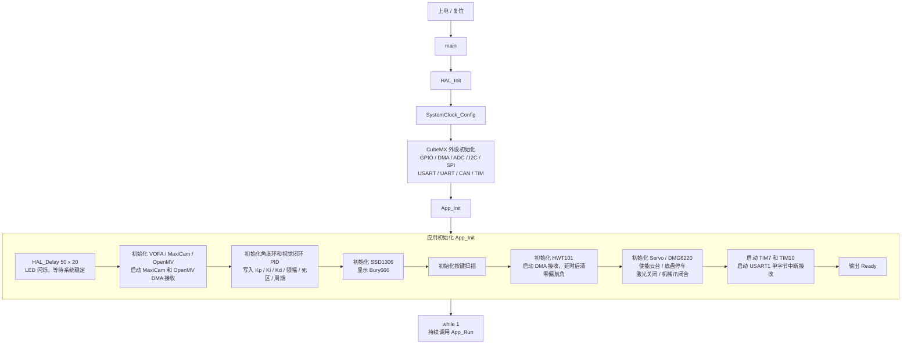
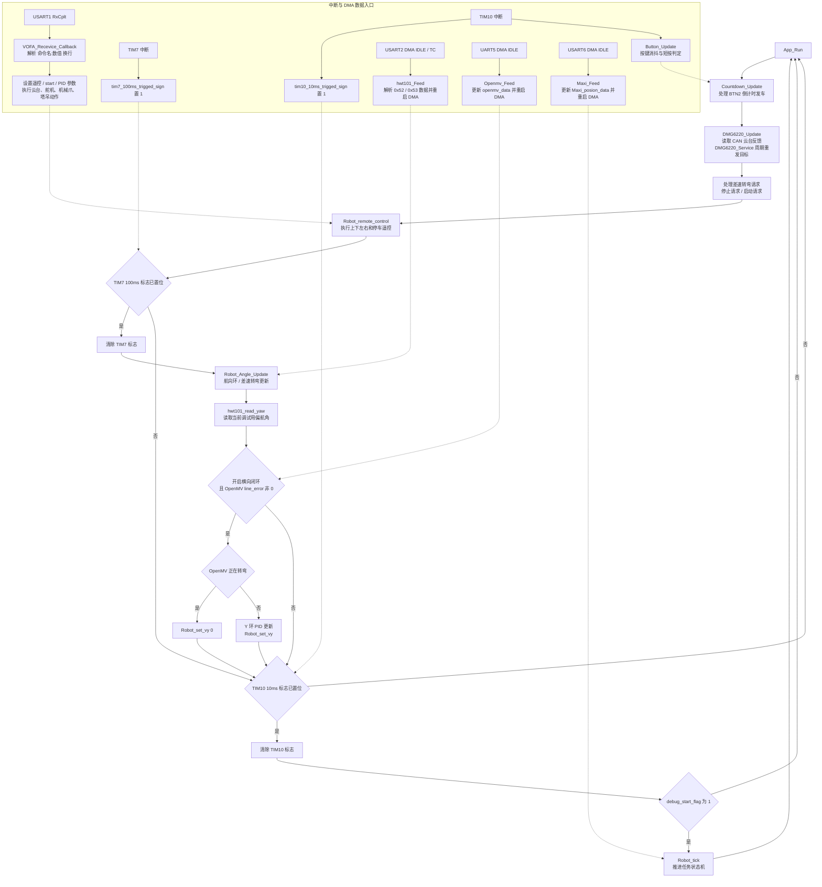
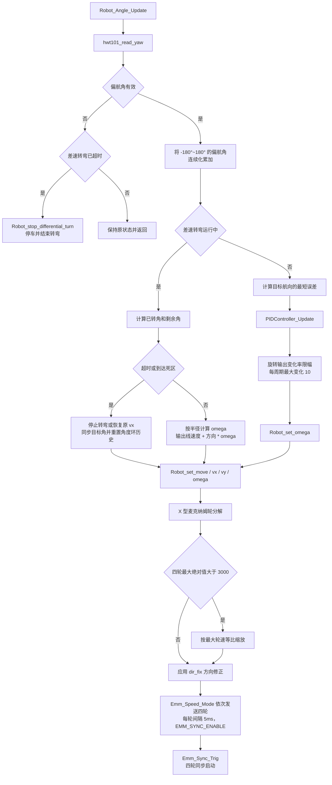

# 2026GECS 工科赛机器人电控系统

2026GECS 是一套基于 STM32F407 的多任务机器人控制固件，面向工科赛机器人任务。项目集成了麦克纳姆轮底盘、云台、机械爪、激光、陀螺仪、视觉定位、巡线相机和上位机调参接口，形成了从感知、控制到任务执行的完整闭环。

## 项目特性

- STM32F407ZGTx 主控，CubeMX + STM32 HAL 基础工程。
- X 型麦克纳姆轮四轮底盘，支持前后、横移和原地旋转。
- HWT101 偏航角反馈，支持航向闭环和连续角度处理。
- MaxiCam 目标坐标定位，支持任务目标位置闭环。
- OpenMV 巡线数据输入，支持横向位置修正。
- DMG6220 云台电机 CAN 控制，支持位置速度模式和周期重发。
- Emm/ZDT 串口总线控制，四轮速度命令、塔吊升降和夹爪伸缩共用一条总线。
- 舵机机械爪、激光模块和 SSD1306 状态显示。
- 差速转弯支持转弯半径、最短方向、角速度限幅和超时退出。
- 纵向里程计按 `vx` 累计脉冲，用于任务二到任务三之间的定距行驶。
- 板载按键触发 3 秒倒计时自动发车，OLED 同步显示倒计时。
- VOFA 风格上位机协议，支持 PID 参数在线调参和遥控。
- 分阶段任务状态机，便于组织比赛流程和任务闭环。

## 系统架构

```text
                         +----------------------+
                         |      MaxiCam         |
                         |  目标坐标/任务编号    |
                         +----------+-----------+
                                    | USART6 DMA
                                    v
+----------------+       +----------------------+       +------------------+
|    OpenMV      | UART5 |                      | CAN1  |   DMG6220 云台    |
| 巡线误差/转弯态 +------>+    STM32F407ZGTx     +------>+   位置速度控制    |
+----------------+       |                      |       +------------------+
                         |  App / Middleware    |
+----------------+       |  Hardware Drivers    |       +------------------+
|    HWT101      | USART2|                      | UART3 |   Emm 总线        |
| 偏航角/角速度  +------>+                      +------>+  四轮/塔吊/伸缩   |
+----------------+ DMA   |                      |       +------------------+
                         |                      |
+----------------+       |                      |       +------------------+
|    VOFA 上位机 +USART1>+                      | PWM   |   舵机机械爪      |
|  调参/遥控      |       |                      +------>+                  |
+----------------+       |                      |       +------------------+
                         |                      |
                         |                      | GPIO  +------------------+
                         |                      +------>+   激光模块        |
                         +----------+-----------+       +------------------+
                                    |
                                    | I2C2
                                    v
                         +----------------------+
                         |     SSD1306 OLED     |
                         +----------------------+
```

## 硬件资源

| 外设 | 引脚或接口 | 用途 |
|---|---|---|
| CAN1 | PA11 / PA12 | DMG6220 云台电机控制 |
| USART1 | PA9 / PA10 | 上位机调参、遥控和调试输出 |
| USART2 | PA2 / PA3 | HWT101 陀螺仪，DMA 接收 |
| USART3 | PB10 / PB11 | ZDT/Emm 总线：四轮 0x01-0x04、夹爪伸缩 0x05、塔吊 0x06 |
| UART5 | PC12 / PD2 | OpenMV 巡线通信，DMA 接收 |
| USART6 | PG14 / PG9 | MaxiCam 目标定位，DMA 接收 |
| I2C1 | PB6 / PB7 | 预留 I2C 接口，标签为 HMC5883L |
| I2C2 | PF0 / PF1 | SSD1306 OLED |
| TIM13 CH1 | PF8 | 舵机 PWM |
| GPIO | PD11 | 激光开关 |
| GPIO | PC13 | 状态 LED |
| GPIO | PG3 / PG4 | BTN1 / BTN2 按键输入，上拉，低电平有效 |
| GPIO | PA15 | 板载按键 |
| GPIO | PE14 | 已配置为输出，当前未使用 |
| GPIO | PG2 | 模拟输入，预留 |
| ADC1 | PA0 | ADC1_IN0，已初始化未使用 |
| SPI1 | PA5 / PA6 / PA7 | 已初始化未使用 |

所有串口和 CAN 的通信速率均为 `115200 8N1`（CAN 为 1 Mbps）。系统时钟直接使用 HSE，没有启用 PLL，`SYSCLK = HCLK = PCLK1 = 8 MHz`，TIM7 与 TIM10 的计数周期据此配置。

## 快速上手

这一节面向第一次接触本项目的同学，目标是在不阅读全部源码的情况下完成编译、烧录、通信检查和底盘测试。

### 1. 准备工具

软件工具：

- VS Code。
- Embedded IDE 扩展，即 EIDE。
- Arm Compiler for Embedded 6，即 AC6。
- ST-Link 调试器或支持 CMSIS-DAP 的调试器。
- 串口助手、VOFA+ 或任意支持 `115200 8N1` 的上位机工具。

硬件模块：

- STM32F407ZGTx 主控板。
- 四个 Emm 轮组驱动器及麦轮底盘。
- DMG6220 云台电机。
- HWT101 陀螺仪。
- MaxiCam 视觉定位模块。
- OpenMV 巡线模块。
- SSD1306 OLED、舵机机械爪和激光模块。

### 2. 打开工程

推荐使用 VS Code 打开：

```text
MDK-ARM/2026GECS.code-workspace
```

工程使用 Embedded IDE 管理源文件，核心构建配置位于：

```text
MDK-ARM/.eide/eide.yml
```

CubeMX 配置文件位于项目根目录：

```text
2026GECS.ioc
```

如果修改了引脚、时钟或外设配置，需要重新生成 CubeMX 代码，并确认 `App`、`Hardware`、`Middleware` 三个目录仍然被加入构建。

### 3. 编译工程

在 VS Code 的 EIDE 面板中执行：

```text
Build
```

构建成功后，默认输出目录为：

```text
MDK-ARM/build/2026GECS/
```

主要产物包括：

- `2026GECS.axf`：调试和下载文件。
- `2026GECS.hex`：通用固件文件。
- `2026GECS.s19`：S19 格式固件文件。

### 4. 烧录固件

使用 ST-Link 或 CMSIS-DAP 连接 SWD：

| 调试器 | 目标板 |
|---|---|
| SWDIO | PA13 |
| SWCLK | PA14 |
| GND | GND |
| 3.3V | 3.3V 参考电平 |

在 EIDE 中选择对应下载器并执行：

```text
Flash
```

烧录完成后复位 MCU。建议第一次测试时断开或架空底盘，确认不会发生意外运动。

### 5. 连接上位机

上位机通过 USART1 与主控通信：

| 主控 | USB 转串口 |
|---|---|
| PA9 / USART1_TX | 接收端 RX |
| PA10 / USART1_RX | 发送端 TX |
| GND | GND |

串口参数固定为：

```text
115200
8 data bits
1 stop bit
No parity
No flow control
```

复位后应能看到类似以下启动信息：

```text
Booting...
Ready
```

如果 OLED 正常显示且串口收到 `Ready`，说明主控已经完成基础初始化，可以继续测试各个外设。

OLED 在启动时显示 `Bury666`，倒数发车过程中显示 `3 / 2 / 1 / GO`。

注意 USART1 同时也是调试输出口：主循环每 100 ms 会打印一次巡线误差和 MaxiCam 坐标（`line_error`、`x,y,position`）。人工输入命令时可以直接忽略这些行，但用脚本自动解析返回值时需要把它们过滤掉。

### 6. 第一次通信测试

先使用只读命令确认上位机通道正常：

```text
Get_yaw:1
```

预期 MCU 返回当前偏航角。若没有返回，优先检查串口接线、波特率和 USART1 中断是否正常。

确认通信正常后，再测试舵机和小范围电机动作。所有运动测试都应在底盘架空或车轮离地的状态下进行。

云台、舵机、塔吊和夹爪都有单独的调试命令，例如 `motor:190`、`servo:135`、`tower_down:1`、`claw_out:1`，用法见下文通信协议一节。

### 7. 推荐首次测试顺序

建议按以下顺序逐项确认，避免多个问题同时出现：

1. LED 是否正常闪烁，OLED 是否显示。
2. USART1 是否能收发上位机命令。
3. HWT101 是否能返回偏航角。
4. Emm 四个轮组是否能单独正转、反转。
5. 底盘前后、横移、旋转方向是否正确。
6. DMG6220 云台是否能在安全范围内运动。
7. 舵机机械爪是否能打开和关闭。
8. MaxiCam 和 OpenMV 是否能输出有效数据。
9. 航向闭环是否能稳定收敛。
10. 最后再运行完整任务状态机。

### 8. 启动任务流程

源码默认从 `ROBOT_STAGE_WAIT_FOR_START` 开始，有两种发车方式：

- 上位机发送 `start:1`，状态机立即从发车阶段开始运行。
- 按下 BTN2，OLED 显示 `3`、`2`、`1`、`GO`，三秒后自动置位启动标志。

倒计时只在 `start` 标志尚未置位、且当前没有倒计时进行时才能触发，避免重复启动。

### 9. 激光硬件位置标定

标定模式不另写一套流程，而是**复用现有的任务状态机**：在**发车前**短按 **BTN1**（PG3），程序调用 `Robot_start_laser_calibration()`，把 `robot_now_stage` 设成 `ROBOT_STAGE_TASK1_DMG_190_WAIT`（就是 `robot.c` 里那行被注释掉的调试入口），然后正常往下跑：

```text
TASK1_DMG_190_WAIT → TASK1_DMG_100_WAIT → TASK1_DONE
  → TASK2（发 Maxi_Send_cmd(0x02) 找标靶，视觉闭环对准）
  → TASK2_DONE（Ray_on() 打激光，标定模式下直接 while(1) 卡住）
```

**标定模式下，`Ray_on()` 之后会进入 `while(1)` 一直卡住**：激光保持点亮、底盘保持停住、云台保持在 `ROBOT_TASK1_DMG_100_ANGLE`（100°），后面的流程不再执行。此时可以直接观察光斑在靶子上的实际位置来标定激光硬件安装；标完按复位键重新上电即可。

要标定激光硬件位置时，看这一段 `Ray_on()` 打在靶子上的光斑即可。

行为约定：

- 只有发车前（`robot_now_stage` 仍是 `ROBOT_STAGE_WAIT_FOR_START`）能进入；已在跑赛中调用 `Robot_start_laser_calibration()` 会直接返回 1。
- 进入时会清掉任务一/任务二/任务三的过程标志和计时，避免沿用残留值。
- 进入后 `debug_start_flag` 会被置 1，让 `Robot_tick()` 正常推进。
- `TASK2_DONE` 里靠 `robot_laser_cal_mode` 区分：标定模式卡住不返回，正常赛程仍然是 2000ms 后 `Ray_off()` 并继续下一段。
- **正常发车不受影响**：BTN2 倒计时和 `start:1` 仍然从 `robot.c` 里的静态初值 `ROBOT_STAGE_WAIT_FOR_START` 开始。
- 需要从别的状态调试，可以调 `Robot_jump_to_stage(stage)`。

BTN2 仍然只负责发车倒计时，两个按键互不影响。

## 目录结构

```text
2026GECS/
├── App/
│   ├── App.c                 # 系统初始化、周期调度和上位机命令处理
│   └── App.h
├── Core/
│   ├── Inc/                  # CubeMX 公共头文件与外设声明
│   └── Src/
│       ├── main.c            # 主程序和外设初始化
│       ├── stm32f4xx_it.c    # 中断向量处理
│       └── stm32f4xx_hal_msp.c
├── Drivers/
│   ├── CMSIS/                # CMSIS 与 STM32F4 设备头文件
│   └── STM32F4xx_HAL_Driver/ # STM32 HAL 驱动
├── Hardware/
│   ├── DMG6220.*             # CAN 云台电机驱动
│   ├── Emm.*                 # ZDT/Emm 总线：四轮、塔吊、夹爪伸缩、里程计
│   ├── hwt101.*              # HWT101 姿态传感器驱动
│   ├── Servo.*               # 舵机 PWM 驱动
│   ├── Ray.*                 # 激光控制
│   ├── Led.* / button.*      # 状态 LED 与按键扫描
│   ├── Debug.*               # printf 重定向
│   ├── SSD1306/              # OLED 显示
│   └── mpu6050/              # MPU6050 驱动及接口，当前未被应用层调用
├── Middleware/
│   ├── robot.*               # 运动学、闭环控制、差速转弯、里程计和任务状态机
│   ├── PID.*                 # 通用 PID 控制器
│   ├── Maxi_Connect.*        # MaxiCam 协议解析
│   ├── Openmv_Connect.*      # OpenMV 协议解析
│   ├── vofamanager.*         # 上位机键值协议
│   └── gyro_integrate.*      # 陀螺仪积分模块
├── MDK-ARM/
│   ├── 2026GECS.code-workspace
│   ├── 2026GECS.uvprojx
│   └── .eide/                # Embedded IDE 构建配置
├── tools/                    # 辅助工具
└── 2026GECS.ioc              # STM32CubeMX 工程配置
```

## 程序运行流程

### 从入口到主循环



初始化中的 DMA 接收会一直存活：USART6 接收 MaxiCam，UART5 接收 OpenMV，USART2 接收 HWT101；USART1 使用完成中断逐字节接收上位机命令。

### 主循环与中断协作



TIM7 和 TIM10 只负责置位触发标志，实际控制逻辑在主循环中执行。这样中断路径较短，也避免在中断中运行 PID、状态机或阻塞式串口发送。

`App_Run()` 会在每次循环里重发云台目标、处理差速转弯请求和遥控输入；TIM7 分支负责 100 ms 的航向环与横向闭环，TIM10 分支负责 10 ms 的任务状态机推进，两者共用同一个 `debug_start_flag` 启动条件。

### 航向、差速转弯与电机输出



云台由 CAN 控制：`DMG6220_MoveAngle()` 保存目标位置和速度，`DMG6220_Service()` 每隔 10ms 重发一次目标；底盘由 Emm 串口驱动，四轮先写入同步缓存，最后一次同步触发统一启动。

### 完整任务状态机

> 当前源码把初始阶段设置为 `ROBOT_STAGE_WAIT_FOR_START`，发送 `start:1` 或按 BTN2 倒计时发车后，会从发车阶段开始执行完整赛程。
>
> `robot.c` 中还保留了一行被注释的 `static Robot_stage robot_now_stage=ROBOT_STAGE_TO_TASK3_STRAIGHT2;`，单独调试任务三时取消注释即可跳过前面的路径。

```mermaid
flowchart TD
    ENTRY{"robot_now_stage 初始值"} -->|"完整赛程（当前源码）"| WAIT
    ENTRY -->|"任务三调试起点（手动切换）"| TASK3

    WAIT["WAIT_FOR_START<br/>vx 为 100，DMG 到 280°"] -->|"立即"| START["START<br/>发车直行"]
    START -->|"robot_time 达到 ROBOT_ROAD_TIME1（102）"| TURN1["TURN1<br/>差速转弯到 90°<br/>半径 131cm，线速度 25"]
    TURN1 -->|"转弯完成"| TURN1_Y_ALIGN["TURN1_Y_ALIGN<br/>停车，开启横向闭环"]
    TURN1_Y_ALIGN -->|"robot_time 达到 ROBOT_Y_ALIGN_TIME（100）"| STRAGE1["STRAGE1<br/>vx 为 100 直行"]
    STRAGE1 -->|"robot_time 达到 ROBOT_ROAD_TIME2（49）"| THROUGH_OBSTACLE["THROUGH_OBSTACLE<br/>差速转弯到 0°"]
    THROUGH_OBSTACLE -->|"转弯完成"| OBSTACLE_WAIT["THROUGH_OBSTACLE_WAIT<br/>停车，开启横向闭环"]
    OBSTACLE_WAIT -->|"robot_time 达到 ROBOT_OBSTACLE_TURN_WAIT_TIME（100）"| TURN2["TURN2<br/>vx 为 70，穿越障碍物"]
    TURN2 -->|"robot_time 达到 ROBOT_ROAD_TIME3（194）"| STRAGE2["STRAGE2<br/>差速转弯到 90°"]
    STRAGE2 -->|"转弯完成"| SCAN_QR["SCAN_QR<br/>vx 为 -50 后退"]
    SCAN_QR -->|"robot_time 达到 ROBOT_QR_BACK_TIME（390）"| QR_WAIT["QR_WAIT<br/>停车等待二维码处理"]
    QR_WAIT -->|"robot_time 达到 ROBOT_QR_WAIT_TIME（150）"| QR_FORWARD["QR_FORWARD<br/>vx 为 50 前进"]
    QR_FORWARD -->|"robot_time 达到 ROBOT_QR_FORWARD_TIME（390）"| TURN3["TURN3<br/>保持前进并继续计时"]
    TURN3 -->|"robot_time 达到 ROBOT_ROAD_TIME4（158）"| STRAGE3["STRAGE3<br/>差速转弯到 0°"]
    STRAGE3 -->|"转弯完成"| FWD1["STRAGE3_FORWARD1<br/>vx 为 50 直行"]
    FWD1 -->|"robot_time 达到 ROBOT_STRAGE3_FORWARD_TIME1（110）"| YALIGN["STRAGE3_Y_ALIGN<br/>停车，开启横向闭环"]
    YALIGN -->|"robot_time 达到 ROBOT_Y_ALIGN_TIME（100）"| TURN4["TURN4<br/>vx 为 100 直行"]
    TURN4 -->|"robot_time 达到 ROBOT_STRAGE3_FORWARD_TIME2（57）"| STRAGE4["STRAGE4<br/>差速转弯到 270°"]
    STRAGE4 -->|"转弯完成"| TASK1["TASK1<br/>vx 为 50，DMG 到 190°<br/>500ms 后发送 MaxiCam 命令 0x01"]

    TASK1 -->|"MaxiCam 有效且误差小于 3，稳定 200ms"| EXTEND_GRIPPER["TASK1_EXTEND_GRIPPER<br/>停车，DMG 到 139°<br/>开爪、塔吊下降、伸爪"]
    EXTEND_GRIPPER -->|"robot_time 达到 300"| CLOSE_GRIPPER["TASK1_CLOSE_GRIPPER<br/>闭合机械爪"]
    CLOSE_GRIPPER -->|"下一 tick"| CLOSE_WAIT["TASK1_CLOSE_GRIPPER_WAIT<br/>等待 100"]
    CLOSE_WAIT -->|"robot_time 达到 100"| TOWER_UP["TASK1_TOWER_UP<br/>塔吊上升"]
    TOWER_UP -->|"robot_time 达到 150"| BACK_BY_POSITION["TASK1_BACK_BY_POSITION<br/>执行 Claw_out2，vx 为 -30<br/>按 position 1/2/3 退 15/143/246 拍"]
    BACK_BY_POSITION -->|"后退时间到"| DMG_BUCKET["TASK1_DMG_TO_BUCKET<br/>DMG 到 280°"]
    DMG_BUCKET -->|"下一 tick"| DMG_BUCKET_WAIT["TASK1_DMG_TO_BUCKET_WAIT<br/>等待 300"]
    DMG_BUCKET_WAIT -->|"robot_time 达到 300"| OPEN_WAIT["TASK1_OPEN_GRIPPER_WAIT<br/>开爪并等待 100"]
    OPEN_WAIT -->|"robot_time 达到 100"| DMG_190_WAIT["TASK1_DMG_190_WAIT<br/>关爪，DMG 到 190°<br/>等待 80"]
    DMG_190_WAIT -->|"robot_time 达到 80"| DMG_100_WAIT["TASK1_DMG_100_WAIT<br/>DMG 到 100°，收爪<br/>等待 200"]
    DMG_100_WAIT -->|"robot_time 达到 200"| TASK1_DONE["TASK1_DONE<br/>vx 为 100，开启横向闭环"]

    TASK1_DONE -->|"robot_time 达到 ROBOT_ROAD_TIME7（230）"| TASK2["TASK2<br/>vx 为 50，开启横向闭环<br/>清零纵向里程，MaxiCam 命令 0x02"]
    TASK2 -->|"误差小于 3，稳定 200ms"| TASK2_DONE["TASK2_DONE<br/>停车，激光开启 2000ms"]
    TASK2_DONE -->|"激光时间到"| STRAIGHT1["TO_TASK3_STRAIGHT1<br/>关闭激光，vx 为 80 直行"]
    STRAIGHT1 -->|"纵向里程达到 ROBOT_ROAD_PULSE1（15000）"| STRAIGHT2["TO_TASK3_STRAIGHT2<br/>差速转弯到 180°"]
    STRAIGHT2 -->|"转弯完成"| TASK3["TASK3<br/>vx 为 30，DMG 到 145°<br/>开爪，清零里程<br/>MaxiCam 命令 0x03"]
    TASK3 -->|"误差小于 4，稳定 200ms"| TASK3_OFFSET["TASK3_OFFSET_FORWARD<br/>vx 为 30，短距离补偿夹爪位置"]
    TASK3_OFFSET -->|"robot_time 达到 ROBOT_ROAD_HOSTAGE_OFFSET_TIME（50）"| DMG_125_WAIT["TASK3_DMG_125_WAIT<br/>停车，DMG 到 110°"]
    DMG_125_WAIT -->|"robot_time 达到 ROBOT_TASK3_DMG_125_WAIT_TIME（135）"| OUT3_WAIT["TASK3_CLAW_OUT3_WAIT<br/>执行 Claw_out3"]
    OUT3_WAIT -->|"robot_time 达到 ROBOT_TASK3_OUT3_WAIT_TIME（50）"| TASK3_CLOSE["TASK3_CLOSE_GRIPPER_WAIT<br/>闭合夹爪"]
    TASK3_CLOSE -->|"robot_time 达到 ROBOT_TASK3_CLOSE_GRIPPER_WAIT_TIME（50）"| TASK3_IN["TASK3_CLAW_IN_WAIT<br/>收回夹爪"]
    TASK3_IN -->|"robot_time 达到 ROBOT_TASK3_CLAW_IN_WAIT_TIME（50）"| TASK3_TO_END["TASK3_TO_END<br/>DMG 到 190°，vx 为 80 前往终点"]
    TASK3_TO_END -->|"robot_time 达到 50"| DMG_235["DMG 到 235°"]
    TASK3_TO_END -->|"纵向里程达到 ROBOT_ROAD_PULSE2（32350）"| FINISH["END<br/>停车结束"]
```



状态机由 `Robot_tick()` 以 10ms 周期推进，每个阶段的阈值都定义在 `Middleware/robot.h` 中，括号里是当前源码的取值，单位是 10ms 节拍。差速转弯运行期间 `Robot_tick()` 会清零 `robot_time` 并直接返回，因此转弯耗时不会计入后续直线段的计时。

三个视觉任务都用 MaxiCam 的 `x` 坐标做闭环，误差进入容差并连续稳定 200ms 后才继续下一步动作；任务二到任务三、任务三到终点这两段改用 Emm 的纵向里程脉冲判断是否走够了距离，不再依赖计时。

## 控制链路

### 麦克纳姆轮运动学

底盘采用 X 型四轮布局，输入量为 `vx`、`vy` 和 `omega`：

```text
w1 = vx + vy - omega
w2 = vx - vy + omega
w3 = vx - vy - omega
w4 = vx + vy + omega
```

四轮命令在发送前进行最大绝对值归一化，任一车轮达到 `WHEEL_MAX_SPEED`（3000）时，其他车轮按比例缩放，以保持底盘运动方向。计算结果还会乘上 `dir_fix[]` 方向修正表，按机械安装方向逐个取反。

四个轮组不是一次性广播的：`Robot_update_move()` 依次发送速度命令，每条之间 `HAL_Delay(5)`，随后调用 `Emm_Sync_Trig()` 让四轮同步启动，避免启动瞬间的相位差。

### 航向控制

航向环以 HWT101 偏航角作为反馈：

1. 读取偏航角并处理跨越正负 180 度的连续角度。
2. 计算目标航向与当前航向之间的最短误差。
3. 通过 PID 计算旋转速度。
4. 对旋转输出变化率进行限制，每个 100ms 周期最多变化 10。
5. 使用积分限幅和误差死区抑制振荡。

角度环的 PID 参数在 `App_Init()` 中初始化，默认 `Kp=1.0`、`Ki=0.019`、`Kd=0.101`，积分限幅为 ±20，误差死区 0.3°。由于 HWT101 的正向与底盘 `omega` 正向相反，输出会乘上 `ROBOT_ANGLE_OUTPUT_SIGN`，改动轮子方向后需要同步检查这个符号。

### 视觉位置控制

MaxiCam 提供目标坐标后，任务控制器使用独立 PID 将坐标误差转换为底盘前后速度：

```text
位置误差 = 目标坐标 - 当前坐标
速度命令 = PID(位置误差)
```

三个任务各有一个独立 PID（小球 134、靶子 300、人质 400），误差进入容差并稳定 200ms 后就算到位。任务一、任务二把 PID 输出的负值直接作为 `vx`，任务三同理；如果目标坐标方向与底盘运动方向不一致，应该先修正符号而不是加大 `Kp`。

OpenMV 提供巡线误差，用于修正横向速度和保持车身相对赛道的位置：

```text
vy = PID(robot_y, openmv_data.line_error)
```

横向闭环只在 `robot_y_pid_is_open` 置位、并且 `line_error` 非 0 时生效；OpenMV 报告处于转弯状态时直接把 `vy` 置 0，避免转弯过程中被横线干扰。

### 纵向里程计

`Robot_update_move()` 会把 `vx` 单独交给 `Emm_Set_Forward_Speed()`，按速度命令累计脉冲，`vy` 和 `omega` 都不计入里程。任务二结束后的直道和任务三到终点的直道用 `Emm_Read_Forward_Pulse_Count()` 判断是否走够距离，阈值分别是 `ROBOT_ROAD_PULSE1`（15000）和 `ROBOT_ROAD_PULSE2`（32350）：

```text
进入直道时 Emm_Clear_Forward_Pulse_Count()
直行过程中累计脉冲
脉冲达到阈值后切换到下一阶段
```

这样就把原来的固定时间行驶换成了按实际行驶距离判断，撞车或打滑时不会继续盲走。

### 差速转弯

差速转弯模块支持以下能力：

- 自动选择最短旋转方向。
- 设置转弯半径和前进线速度。
- 角速度限幅。
- 到位死区判断。
- 超时退出。
- 转弯结束后恢复原前后速度。
- 重置角度环历史状态，减少回抽。

角速度按 `omega = linear_speed * 100 / radius_cm` 计算，上限 `ROBOT_DIFF_TURN_MAX_OMEGA`（500）；半径小于 0.1cm 时退化为原地旋转。到位死区 1°，超时时间 30s，超时后停车并把 `robot_angle` 同步到当前连续角度。赛程中所有差速转弯都使用半径 131cm、线速度 25。

## 任务状态机

完整的阶段迁移、时间阈值和执行动作见上文 [程序运行流程](#程序运行流程) 中的“完整任务状态机”流程图。任务层可拆分为以下比赛链路：

```text
等待启动
  -> 发车直行
  -> 差速转弯
  -> 障碍物穿越
  -> 二维码扫描与等待
  -> 多段路径行驶
  -> 任务一视觉闭环
  -> 任务二视觉闭环与激光动作
  -> 任务三视觉闭环
  -> 前往终点
  -> 停车结束
```

状态机以 10ms 周期推进。差速转弯运行期间暂停普通阶段计时，避免转弯耗时影响后续运动时间。

当前源码默认从 `ROBOT_STAGE_WAIT_FOR_START` 开始，发送 `start:1` 或按 BTN2 倒计时发车后，会从“等待启动”和发车阶段开始运行完整比赛链路。

阶段名称与 `Middleware/robot.h` 中的 `Robot_stage` 枚举一一对应，迁移条件集中在 `Middleware/robot.c` 的 `Robot_tick()` 里，调整赛段时只需要改这个函数和 `robot.h` 中的时间常量。

## 通信协议

### MaxiCam

固定长度为 7 字节：

```text
Byte 0      Byte 1-2     Byte 3-4     Byte 5       Byte 6
0xAA        X 高/低字节   Y 高/低字节  目标位置编号  0xD0
```

坐标采用大端格式。接收成功后，`state = 0`；帧头、帧尾不匹配时，`state = 1`。

### OpenMV

固定长度为 4 字节：

```text
Byte 0      Byte 1          Byte 2           Byte 3
0xAA        line_error      turning_state    0xD0
```

- `line_error`：巡线误差。
- `turning_state`：`1` 表示处于转弯状态，`0` 表示正常巡线。
- `state = 0` 表示解析成功，`state = 1` 表示解析失败。

### HWT101

传感器连续输出 11 字节数据帧：

```text
Byte 0      Byte 1      Byte 6-7
0x55        0x52/0x53   数据低字节/高字节
```

- `0x52`：角速度帧。
- `0x53`：偏航角帧。

驱动对连续到达的多帧数据进行逐个解析。

### VOFA 上位机协议

每条命令使用以下格式：

```text
命令名:数值\n
```

支持的主要命令：

| 命令 | 功能 |
|---|---|
| `motor:<angle>` | 设置云台目标角度 |
| `servo:<angle>` | 设置舵机角度 |
| `Get_yaw:<value>` | 读取当前偏航角并打印 |
| `Reset_mcu:<value>` | 复位 MCU |
| `start:<value>` | 允许任务状态机运行 |
| `forward:<1/0>` | 前进控制，非 1 视为停止 |
| `backward:<1/0>` | 后退控制 |
| `left:<1/0>` | 左移控制，置 1 时同时关闭横向闭环 |
| `right:<1/0>` | 右移控制，置 1 时同时关闭横向闭环 |
| `Stop:<value>` | 停车并结束正在进行的差速转弯 |
| `Kp:<value>` / `Ki:<value>` / `Kd:<value>` | 分别设置航向环 Kp、Ki、Kd |
| `angle:<value>` | 设置目标航向角 |
| `turn:<value>` | 目标航向增加 90 度 |
| `diff_radius:<value>` | 设置差速转弯半径 |
| `diff_turn:<angle>` | 启动一次差速转弯到指定的绝对航向 |
| `high:<position>` | 塔吊升降的相对位置命令 |
| `tower_down:<value>` | 塔吊下降到最低位 |
| `tower_up:<value>` | 塔吊上升到最高位 |
| `claw_out:<value>` | 夹爪伸缩机构伸出到 out1 位置 |
| `claw_in:<value>` | 夹爪伸缩机构收回 |
| `ypid:<value>` | 反转横向闭环开关 |

命令名需要完全匹配，区分大小写；数值部分由 `VOFA_Recevice_Callback()` 解析成 `float`，没有实际用到的值可以任意填写。

## 构建环境

推荐使用 VS Code + Embedded IDE 构建：

- MCU：STM32F407ZGTx。
- 工具链：Arm Compiler for Embedded 6，即 AC6。
- 工程工作区：`MDK-ARM/2026GECS.code-workspace`。
- EIDE 配置：`MDK-ARM/.eide/eide.yml`。
- CubeMX 配置：`2026GECS.ioc`。
- 输出目录：`MDK-ARM/build/2026GECS/`。

### 构建步骤

1. 安装 VS Code 和 Embedded IDE 扩展。
2. 使用 VS Code 打开 `MDK-ARM/2026GECS.code-workspace`。
3. 确认已配置 Arm Compiler 6 工具链。
4. 在 EIDE 中执行 `Build`。
5. 构建成功后生成 `2026GECS.axf`、`2026GECS.hex` 和 `2026GECS.s19`。

也可以使用 Keil MDK 打开 `MDK-ARM/2026GECS.uvprojx`，但需要注意不同 IDE 的项目源文件和包含路径配置可能并不完全一致，实际构建以 EIDE 工程为准。

## 烧录与运行

项目支持通过 ST-Link 或 OpenOCD 烧录。EIDE 中可选择：

- `STLink`：SWD 接口，默认下载地址 `0x08000000`。
- `OpenOCD`：CMSIS-DAP 接口，默认目标 `stm32f4x`。
- `JLink`：默认速度 `8000 kHz`。

推荐运行流程：

1. 上电前确认底盘悬空或处于安全区域，避免电机突然运动。
2. 连接调试器和上位机串口。
3. 烧录并复位控制器。
4. 确认 OLED、CAN 云台和各串口设备初始化正常。
5. 使用上位机发送 `start:1`，或按 BTN2 走完 3 秒倒计时，启动任务状态机。
6. 调试期间使用 `Stop:1` 或遥控命令停止底盘。

## 关键配置位置

| 配置内容 | 位置 |
|---|---|
| PID 参数 | `App/App.c` 的 `App_Init()` |
| 航向环 | `Middleware/robot.c` 的 `Robot_Angle_Update()` |
| 差速转弯参数 | `Middleware/robot.h` 和 `Middleware/robot.c` |
| 麦克纳姆轮速度分解 | `Middleware/robot.c` 的 `Robot_update_move()` |
| 方向修正 | `Middleware/robot.c` 的 `dir_fix[]` 和 `ROBOT_ANGLE_OUTPUT_SIGN` |
| 横向闭环目标 | `App/App.c` 的 `robot_y`，默认 28，任务三前段改为 32 |
| 任务阶段定义 | `Middleware/robot.h` 的 `Robot_stage` |
| 赛段时间常量 | `Middleware/robot.h` 的 `ROBOT_ROAD_TIME*`、`ROBOT_QR_*`、`ROBOT_TASK*` 等宏 |
| 里程阈值 | `Middleware/robot.h` 的 `ROBOT_ROAD_PULSE1` 和 `ROBOT_ROAD_PULSE2` |
| 任务状态机 | `Middleware/robot.c` 的 `Robot_tick()` |
| 视觉任务目标与容差 | `Middleware/robot.h` 的 `ROBOT_TASK*_TARGET` 和 `*_ERROR_TOLERANCE` |
| 夹爪、塔吊与伸缩动作 | `Middleware/robot.c` 的 `Robot_Claw_*()` 和 `Robot_Tower_*()` |
| 按键倒计时发车 | `App/App.c` 的 `Countdown_Update()` |
| MaxiCam 协议 | `Middleware/Maxi_Connect.c` |
| OpenMV 协议 | `Middleware/Openmv_Connect.c` |
| VOFA 命令 | `App/App.c` 的 `VOFA_Get_Package_Callback()` |
| CAN 云台驱动 | `Hardware/DMG6220.c` |
| 四轮组与执行机构通信 | `Hardware/Emm.c` |
| 系统时钟 | `Core/Src/main.c` 的 `SystemClock_Config()`，HSE 直连 8MHz |

## 安全注意事项

- 激光模块可能对眼睛造成伤害，调试和运行时应避免直视光源。
- 修改电机方向、PID 符号或速度限幅前，应先架空底盘测试。
- 修改 CAN、串口或定时器配置后，应重新检查通信速率和控制周期。
- 调试传感器、视觉模块或机械执行机构时，不要让机器人处于无人看管状态。
- 正式比赛前应确认急停、遥控停车和机械行程限制有效。

## 调参建议

本项目同时包含底盘、姿态、视觉和任务状态机，不建议一次修改多个参数。推荐按以下顺序完成调试。

### 1. 先检查运动方向

逐个控制四个轮组，确认每个电机的正方向和轮子实际转向一致。若某一轮方向相反，先修改 `Middleware/robot.c` 中的方向修正表，不要先调整 PID。

### 2. 再调航向环

先让底盘静止，确认 HWT101 角度稳定，再逐步增加 Kp。出现低频摆动时适当增加 Kd，出现长期偏差时再加入较小 Ki。每次修改后都要观察角度误差和电机输出，避免直接给大积分。

### 3. 调差速转弯

航向环稳定后，再调试差速转弯。重点观察：

- 转弯方向是否正确。
- 实际转弯半径是否接近设定值。
- 到位后是否停止或按预期恢复运动。
- 转弯过程中是否出现角速度饱和或抖动。

### 4. 调视觉位置环

视觉环建立在底盘方向和航向控制正确的基础上。建议先固定机器人测试坐标变化方向，再调整位置 PID。若目标坐标方向与底盘运动方向相反，应先修正符号，而不是增大 Kp。

### 5. 最后调任务状态机

只有底盘、航向、视觉和执行机构都能独立工作后，才适合运行完整任务。状态机调试时，应逐段确认每个阶段的入口条件、完成条件和退出动作。

## 常见问题排查

### 上位机没有返回数据

- 检查 USART1 是否使用 `115200 8N1`。
- 检查 TX 和 RX 是否交叉连接。
- 检查主控与 USB 转串口是否共地。
- 确认上位机命令以换行符结束，例如 `Get_yaw:1\n`。
- 注意 `line_error` 和 MaxiCam 坐标的周期打印也占用 USART1，脚本解析时需要过滤这些行。

### 发送 start 后底盘不动

- 确认命令为 `start:1` 并以换行结束，不是 `start:0`。
- 确认 OLED 已完成倒计时或已收到启动命令，`debug_start_flag` 为 1。
- 确认 TIM10 中断正常触发，10ms 标志位能置位。
- 确认 Emm 驱动器已使能，并且 `Robot_tick()` 里的当前阶段确实要求底盘运动。

### OLED 不显示

- 检查 I2C2 的 PF0 和 PF1 接线。
- 检查 OLED 地址和供电。
- 确认 `ssd1306_Init(&hi2c2)` 已执行。

### HWT101 无有效角度

- 检查 USART2 的 PA2、PA3 接线。
- 确认传感器波特率和输出模式正确。
- 检查 DMA 接收是否正常重启。
- 使用 `Get_yaw:1` 观察返回结果。

### 底盘运动方向错误

- 逐个检查四个轮组的机械安装方向。
- 检查 Emm 驱动器的地址是否和控制代码一致。
- 检查 `dir_fix` 方向修正表。
- 检查 `vx`、`vy`、`omega` 的符号定义。

### 云台无法运动

- 检查 CAN 收发器和 120 欧姆终端电阻。
- 检查 CAN 波特率是否正确。
- 确认 DMG6220 已进入位置速度模式。
- 检查 CAN ID 是否和 `DMG6220_Init()` 中一致。
- 观察是否存在 CAN 发送失败或反馈丢失。

### 航向角持续振荡

- 先降低 Kp。
- 适当增大转角输出限幅或降低目标变化速度。
- 检查 HWT101 的安装是否牢固。
- 检查控制周期是否与 PID 的 `T` 参数一致。
- 检查电机方向是否正确，符号错误会让闭环表现为持续发散。

### 摄像头数据无效

- 检查串口是否使用正确的 USART/UART。
- 检查帧头、帧尾、帧长度和数据字节序。
- 检查视觉模块的波特率是否与主控一致。
- 检查视觉模块输出的是否是当前协议版本。
- 确认 MaxiCam 的 `state` 为 0，否则任务状态机会一直等待有效坐标。

## 开发规范

- 修改参数后先进行单模块测试，再运行完整任务。
- 新增外设时优先在 `Hardware` 中添加驱动。
- 新增协议和控制逻辑优先放在 `Middleware` 中。
- 新增任务时明确任务入口、完成条件和异常退出路径。
- 不要在不同模块中重复定义同一份硬件数据。
- 使用 DMA 接收时，注意缓冲区长度和重启接收的时机。
- 修改控制参数后记录参数值、测试条件和机器人行为，便于复现。
- 涉及运动、激光和机械结构的修改，必须先确认安全状态。

## 后续开发方向

1. 将 `robot.c` 拆分为底盘控制、航向控制、差速转弯和任务状态机模块。
2. 建立统一的机器人上下文对象，减少跨模块 `extern` 全局变量。
3. 为每个传感器数据增加时间戳、有效性和超时状态。
4. 使用固定周期调度器统一管理 10 ms 和 100 ms 任务，替代当前的标志位轮询。
5. 将串口中断中的复杂命令处理移动到主循环任务队列。
6. 为 PID、协议解析和任务状态机增加单元测试或硬件在环测试。
7. 增加日志、故障码和控制参数持久化机制。
8. 把任务状态机的阶段迁移与动作抽取成表驱动结构，减少 `Robot_tick()` 中的长分支。
9. 让三个视觉任务的 PID 参数和目标值可以运行时下发，不再需要重新编译。
